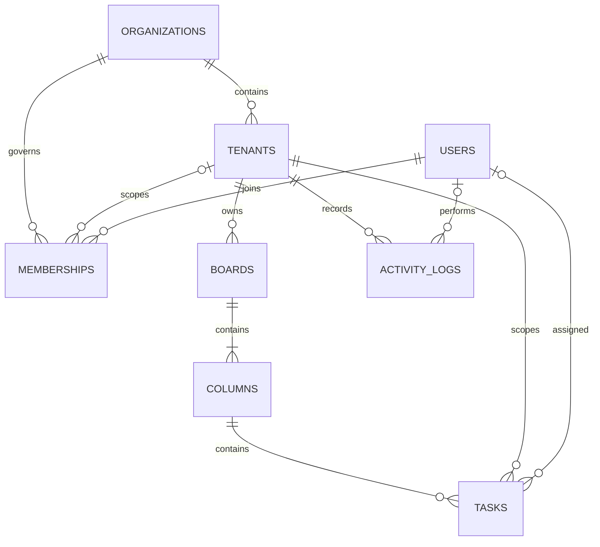

# Branchboard

Branchboard is a small, runnable collaborative Kanban app built with Node.js, Express, SQLite, and WebSockets. The browser UI is vanilla JavaScript; SQLite is the durable source of truth and WebSockets carry tenant-scoped board and presence updates.

## Run locally

Requires Node.js 18 or later.

```powershell
npm install
npm start
```

Open [http://localhost:3000](http://localhost:3000). The database is created at `data/branchboard.sqlite` on first run. Set `PORT` or `DATABASE_PATH` to override the defaults.

### Demo accounts

All demo accounts use `demo123`.

| Role | Email | Access |
|---|---|---|
| Organization admin | `admin@atlas.demo` | Atlas Studio and its branches |
| Branch admin | `lead@atlas.demo` | Design Studio |
| Member | `jamie@atlas.demo` | Design Studio |
| Member | `taylor@atlas.demo` | Customer Success |
| Organization admin | `admin@northstar.demo` | Northstar Labs and its branch |

Seed data is inserted only when the organizations table is empty. To reset demo data, stop the server and remove the specific `data/branchboard.sqlite`, `data/branchboard.sqlite-shm`, and `data/branchboard.sqlite-wal` files.

## Architecture and tenancy



- Every board, column, task, and activity event has a `tenant_id`; composite foreign keys require a board and its columns/tasks to belong to the same tenant.
- An organization admin has an organization-level membership (`tenant_id IS NULL`) and can work in each branch. Branch admins and members have branch-specific memberships. The tenant authorization check resolves membership through the requested tenant's organization and fails closed (a non-member receives 404).
- Queries for business records always include the authorized `tenant_id`, including board lookup, task mutation, column membership, activity feed, and assignee validation. A task cannot be moved to another tenant's column.
- Sessions are random, HttpOnly, SameSite=Strict cookies; only their SHA-256 digests are stored. Set `COOKIE_SECURE=true` when serving over HTTPS. Demo passwords are scrypt-hashed. For internet-facing deployment, add TLS, rate limiting, managed secrets, account provisioning, CSRF/origin policy, and operational backups.
- A single Node process owns the WebSocket presence registry. SQLite WAL supports concurrent readers; writes are short transactions. For multi-process or multi-region deployment, move persistence to PostgreSQL and fan out tenant events/presence via a broker (for example Redis or NATS).

## Concurrency and recovery

Tasks have a monotonically increasing `version`. Every task edit, move, or delete requires the client's expected version. Stale writes return HTTP `409 Conflict` and do not overwrite the winning change. Reordering is a transaction: it checks the moved task's version and normalizes positions in the target/source columns using integer gaps. SQLite serializes the write transaction, so overlapping reorders leave a consistent order. Clients reload the authoritative board after a conflict.

The UI applies edits and drag/drop optimistically, then persists them. Failed writes reload server state; undo/redo replays task changes as version-checked API requests. WebSocket disconnects retry automatically; HTTP remains the source of truth after reconnect. Presence reflects connected sockets, not a durable online status.

## REST API

All `/api` endpoints except login and logout require the session cookie. JSON errors have an `error` field. Tenant-scoped endpoints require `tenant_id`; missing or unauthorized tenants fail closed. Organization-admin and branch-admin restrictions are applied at the server, not just hidden in the UI.

| Method | Path | Purpose |
|---|---|---|
| POST | `/api/auth/login` | Sign in with email/password |
| POST | `/api/auth/logout` | Revoke session |
| GET | `/api/me` | Current user, organizations, and memberships |
| GET / POST | `/api/organizations` | List accessible organizations / create an organization |
| PATCH / DELETE | `/api/organizations/:id` | Rename / delete an organization (organization admin) |
| GET | `/api/organizations/:organizationId/tenants` | List accessible branches |
| POST | `/api/tenants` | Create branch (organization admin) |
| PATCH / DELETE | `/api/tenants/:tenantId` | Rename / delete branch (organization admin) |
| GET | `/api/boards?tenant_id=…` | List tenant boards |
| GET | `/api/boards/:boardId?tenant_id=…` | Read a board with columns and tasks |
| POST | `/api/boards` | Create a board and starter columns (branch admin) |
| PATCH / DELETE | `/api/boards/:boardId` | Rename / delete board (branch admin) |
| GET | `/api/columns?tenant_id=…&board_id=…` | List board columns |
| POST | `/api/columns` | Add column (branch admin) |
| PATCH / DELETE | `/api/columns/:columnId` | Rename / delete an empty column (branch admin) |
| POST | `/api/tasks` | Create a task |
| PATCH | `/api/tasks/:taskId` | Edit or move task; requires `expected_version` |
| DELETE | `/api/tasks/:taskId?tenant_id=…&expected_version=…` | Delete task with version check |
| GET | `/api/activity?tenant_id=…` | Read tenant activity (up to 100 events) |
| GET | `/api/tenant-members?tenant_id=…` | List members assignable in the tenant |

Task PATCH accepts `title`, `description`, `assignee_id`, `due_date`, `column_id`, and `position`. For example:

```json
{
  "tenant_id": "…",
  "expected_version": 3,
  "column_id": "…",
  "position": 1,
  "title": "Review the launch plan"
}
```

## WebSocket protocol

Connect to `ws://<host>/realtime` (or `wss://` behind TLS) using the authenticated session cookie. Subscribe with:

```json
{ "type": "subscribe", "tenant_id": "…" }
```

The server validates membership before joining the channel. A socket may subscribe to one tenant at a time; subscribing again replaces its previous channel. Events are JSON envelopes with `type`, `tenant_id`, and `data`:

- `subscribed` confirms a subscription.
- `boards.updated` asks clients to refresh the tenant's board list.
- `board.updated` contains the complete tenant-scoped board snapshot.
- `board.deleted` contains the deleted `board_id`.
- `activity.updated` asks clients to refresh the tenant activity feed.
- `presence.updated` contains the connected users in the tenant.
- `error` reports an invalid subscription/message.

## Checks

```powershell
npm test
```
